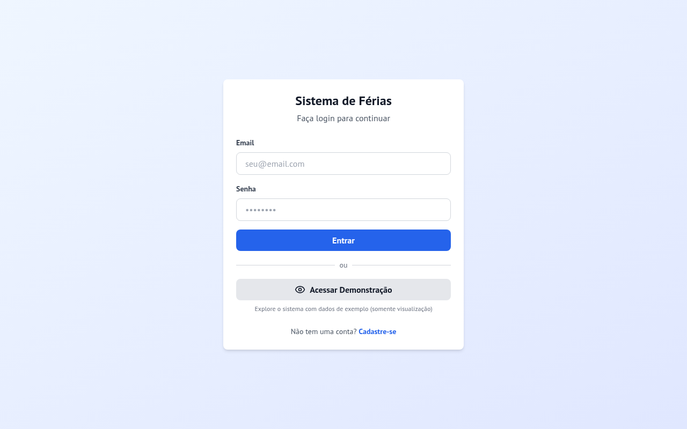
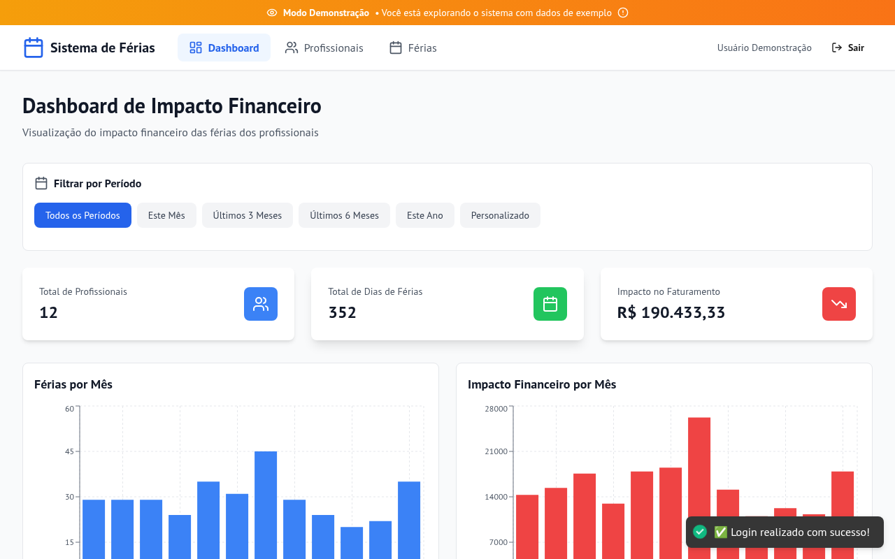
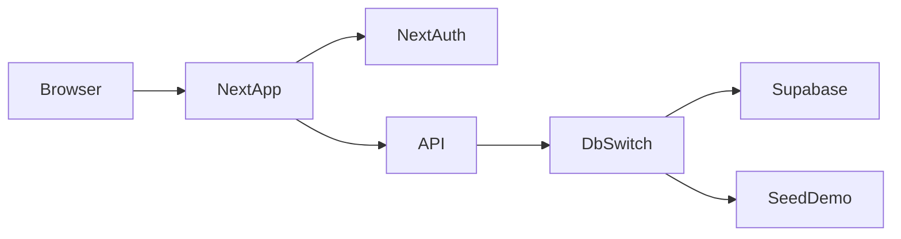

# Sistema de Férias

Vacation management for Brazilian teams: track acquisition and usage periods, revenue impact, and professionals in one Next.js app.

[](https://github.com/unchain0/sistema-ferias/actions/workflows/ci.yml)
[](./.nvmrc)
[](./tsconfig.json)
[](./LICENSE.txt)
[](./package.json)

## Live UI

Login screen (running app on `localhost:5000`):



Demo dashboard after seed login:



## Features

- Acquisition and usage period tracking per professional
- Dashboard with vacation days and revenue impact
- Professional CRUD with client manager and monthly revenue
- Demo mode with seeded data when Supabase is unavailable
- Rate limiting on auth endpoints
- Zod input validation and UUIDv7 identifiers (OS CSPRNG)
- NextAuth credentials auth with bcrypt password hashing

## Quick start

**Prerequisites:** Node.js 22+ (see `.nvmrc`), npm 10+

```bash
git clone https://github.com/unchain0/sistema-ferias.git
cd sistema-ferias
npm ci --legacy-peer-deps
cp .env.example .env.local
# Set at least NEXTAUTH_SECRET (32+ chars) and NEXTAUTH_URL=http://localhost:5000
npm run dev
```

Open [http://localhost:5000](http://localhost:5000).

### Demo account

| Field    | Value                     |
|----------|---------------------------|
| Email    | `demo@sistema-ferias.com` |
| Password | `demo123`                 |

Demo mode works without Supabase using an in-memory seed store.

## Configuration

| Variable | Description | Required |
|----------|-------------|----------|
| `NEXTAUTH_SECRET` | NextAuth signing secret | Yes |
| `NEXTAUTH_URL` | Public app URL | Yes |
| `NEXT_PUBLIC_SUPABASE_URL` | Supabase project URL | No (demo works without) |
| `NEXT_PUBLIC_SUPABASE_ANON_KEY` | Supabase anon key | No |
| `SUPABASE_JWT_SECRET` | Supabase JWT secret | Yes (when using Supabase) |
| `DEMO_MODE` | Force demo path (`true`/`false`) | No |

See [`.env.example`](./.env.example). Never commit real secrets.

## Stack

- Next.js 15 App Router, React 18, TypeScript (strict)
- Tailwind CSS
- Supabase PostgreSQL with JSON/memory fallback for demo
- NextAuth.js, Zod, c8 coverage, fast-check property tests, Stryker mutation tests



## Development

```bash
npm run lint          # ESLint strict type-checked, max-warnings 0
npm run typecheck     # tsc --noEmit (app + node configs)
npm run complexity    # complexity and size limits via ESLint
npm test              # unit + property + regression tests
npm run test:coverage # c8 with 90% branch gate on pure lib modules
npm run test:property # fast-check properties
npm run test:mutation # Stryker on pure lib modules
npm run build         # production build
```

### Engineering standards

- TypeScript: `strict`, `noUncheckedIndexedAccess`, `exactOptionalPropertyTypes`
- ESLint: `strictTypeChecked`, complexity ≤ 15 (pages higher), max file/function size
- IDs: UUIDv7 via `lib/uuid-v7.ts` and `crypto.randomBytes` (OS CSPRNG)
- Coverage: ≥ 90% branches on covered pure modules
- CI treats warnings as errors; no `continue-on-error` / `|| true` on quality gates

## CI/CD and quality

GitHub Actions (`.github/workflows/ci.yml`) on `ubuntu-latest`:

1. Lint, typecheck, complexity
2. Tests and 90% branch coverage
3. audit-ci, gitleaks, OSV scanner, knip
4. Stryker mutation testing
5. Production build
6. actionlint + zizmor (pinned action SHAs, `contents: read`)

Concurrency cancels in-progress runs on the same ref. npm cache is enabled.

## Project layout

```
app/            # App Router pages and API routes
components/     # UI components
lib/            # Auth, storage switch, validation, UUIDv7, utils
test/           # node:test unit, property, and regression tests
docs/assets/    # Real screenshots from the running app
.github/        # CI, gitleaks, audit-ci, osv-scanner config
```

## Status

| Field | Value |
|-------|-------|
| Objective | Manage vacation periods and revenue impact for professionals |
| Status | Active development |
| Demo | Built-in seed account (no external DB required) |

## Contributing

1. Fork and create a branch
2. Use Conventional Commits (`feat:`, `fix:`, `chore:`, …)
3. Keep `npm run lint`, `typecheck`, and `test:coverage` green
4. Open a PR against `main`

## License

MIT. See [LICENSE.txt](./LICENSE.txt).
